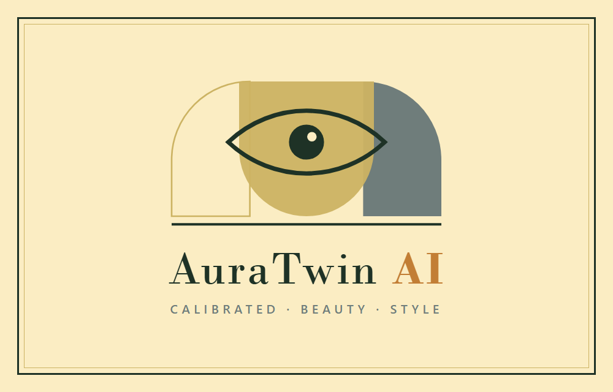
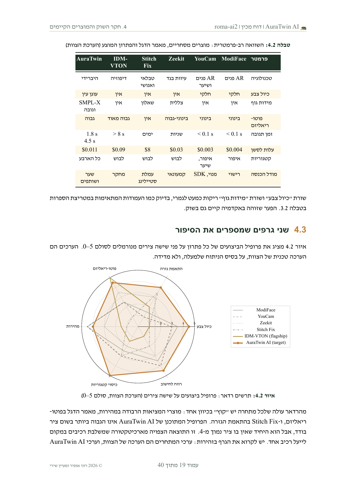
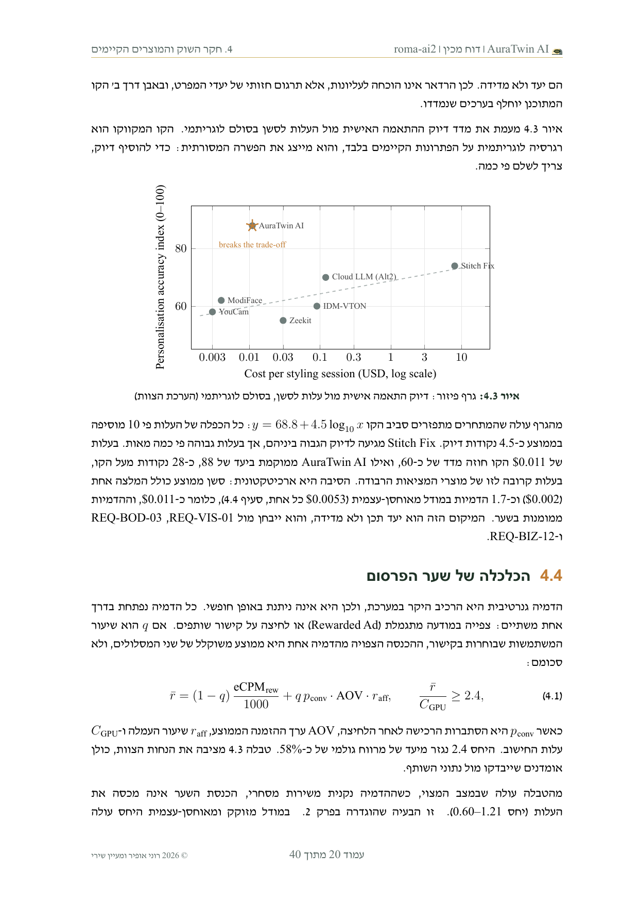
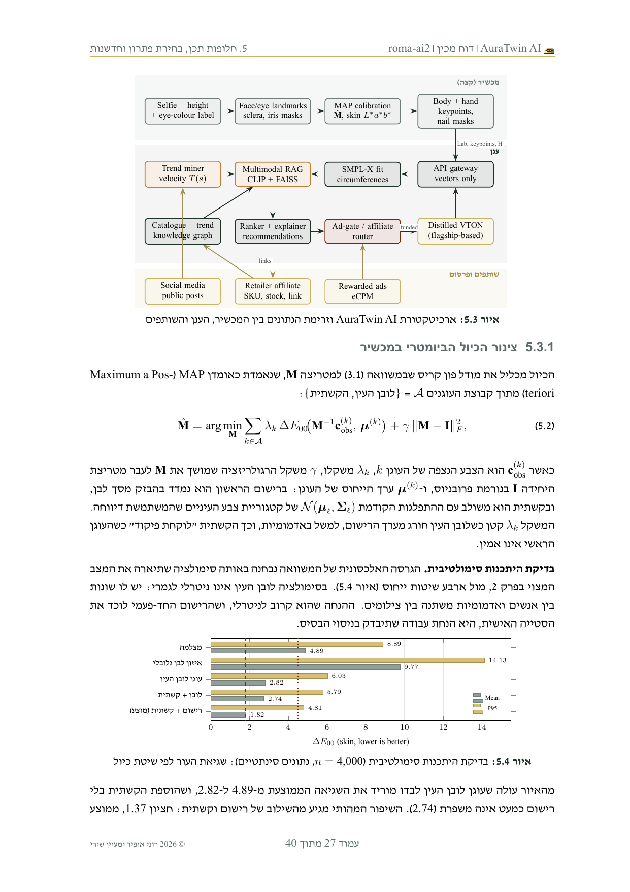
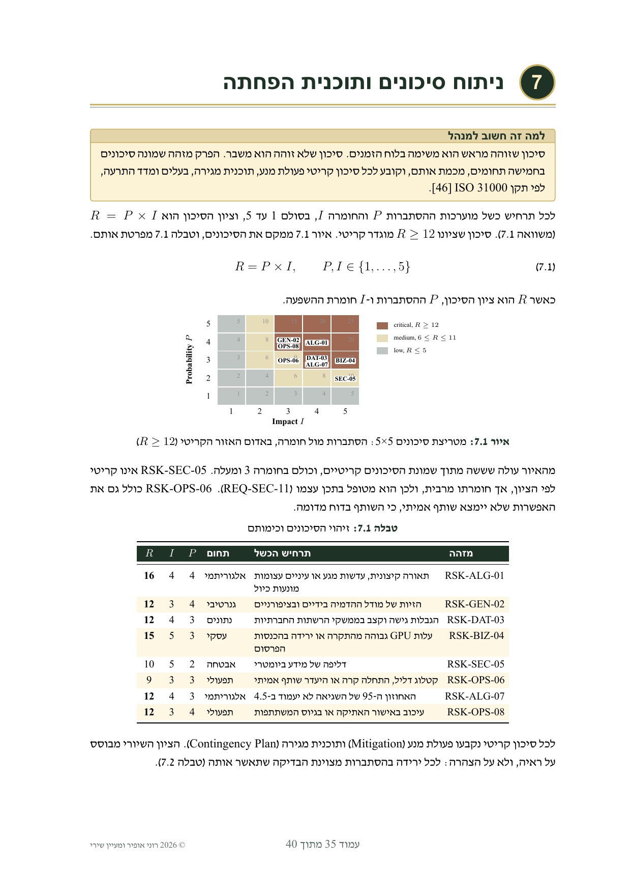
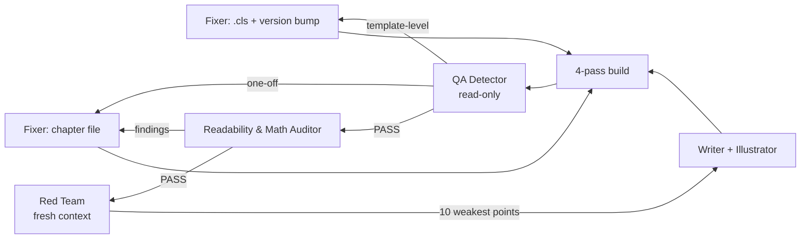

<div align="center">



# AuraTwin AI — דוח מכין · Preliminary Design Report

**Multi-Modal Agentic Operating System for Self-Calibrated Biometric Beauty & Fashion Styling,
Social Trend Mining, and Ad-Gated Generative Virtual Try-On**


**רוני אופיר · מעיין שירי**, החוג לסטטיסטיקה, אוניברסיטת חיפה · מנחה: ד"ר יורם סגל
יישומי AI ו-Vibe Coding במדע וביום-יום / סמינריון מחקרי בניהול טכנולוגיות, 2026 · קוד קבוצה `roma-ai2`

📄 **[report/report.pdf](report/report.pdf)** · 📋 [PRD.md](PRD.md) · 🧠 [prompts/](prompts/) · 📝 [CHANGELOG.md](CHANGELOG.md) · 🧩 [skills/](skills/)

</div>

---

## החזון · Vision

**למה העולם צריך את זה עכשיו.** הבינה המלאכותית כבר כותבת, מתכנתת, מנווטת ומשווה מחירים בשבילנו. אבל ההחלטה
שחוזרת אצל רוב האנשים מדי בוקר, איך להיראות היום, עדיין מתקבלת מול מראה בתאורת חדר, בניחוש של גוון, מידה
ושילוב. **AuraTwin AI** הוא תוסף דפדפן ואפליקציה נלווית שהופכים את הניחוש להחלטה מכוילת, בשני הרגעים
שבהם היא נדרשת: בבוקר מול הארון, ובזמן קנייה מקוונת.

**למי.** הקהל רחב וחוצה גילים ומגדרים:
- **נערות** שבונות סגנון אישי ומושפעות מטרנדים שמתחלפים בתוך שבועות;
- **נשים בכל גיל** שמשלבות לבוש, איפור וציפורניים בזמן מוגבל;
- **גברים** בעלי מודעות גבוהה לטיפוח ולסגנון, שרוצים למקסם את הופעתם בלי להפוך למומחים.

אין בממשק ברירות מחדל מגדריות: ההמלצה נקבעת לפי הגוף והגוון, לא לפי הנחה.

**How it works.** The user's colours are calibrated with biometric anchors in the eye: the sclera, measured once
with a screen flash, and the self-reported eye colour as a Bayesian prior. Body circumferences come from SMPL-X
plus the reported height. A multimodal RAG engine matches the catalogue against live social trends. A distilled
diffusion try-on runs only behind a value-exchange gate (a 15 s rewarded video, an affiliate click or VIP), so
every generation is paid for before the GPU starts.

### The 4-step user journey (report Fig. 4.4)

| # | Step | Budget | Measured by |
|---|---|---|---|
| 1 | Onboarding in 30 seconds: eye colour, height, weight, circumferences, 3 snapshots (face, body, hands) | ≤ 30 s, once | REQ-VIS-02 |
| 2 | Instant daily / shopping assistant: outfit, makeup shade, nail polish, live trends | ≤ 1.8 s | REQ-LAT-05, REQ-REC-10, REQ-TRD-09 |
| 3 | Value-exchange gate (optional): 15 s rewarded video or VIP unlocks a try-on of *me* | 15 s + ≤ 4.5 s | REQ-GEN-06/07/08, REQ-BIZ-12 |
| 4 | 1-click sponsored shop-the-look cards at paying retail partners | 1 click | REQ-REC-10 |

## Visual identity — "Luxury, Vintage, Bold"

| Swatch | Name | Hex | RGB | Role in the report |
|---|---|---|---|---|
|  | **Egg Nog** | `#FBEDC3` | 251, 237, 195 | soft backgrounds of boxes, cards, cover, logo |
|  | **Mustard** | `#CCB363` | 204, 179, 99 | antique-gold rules and frames, flagship series |
|  | **Dust** | `#6F7D7B` | 111, 125, 123 | sub-headings, system boxes, axes, competitors |
|  | **Copper** | `#C27E35` | 194, 126, 53 | examples, **AuraTwin / proposed solution**, section numbers |
|  | **Garnet** | `#76290B` | 118, 41, 11 | warnings, critical risks, critical path |
|  | **Velvet Forest** | `#1E3226` | 30, 50, 38 | chapter titles, cover frame, table headers |

The **logo** combines three interlocking arches from the palette card: an Egg Nog top-left arch, a Mustard
inverted dome and a Dust top-right arch. A thin Velvet Forest eye crosses them, standing for biometric
calibration. It is a TikZ macro (`\auratwinlogo`, used on the cover and in every page header) and a PNG
generated from the same geometry (`scripts/render_hyperframes_cover.py`).

## Preview of the compiled report

| | | |
|:-:|:-:|:-:|
| <br>Cover (א׳) | <br>Audience & user journey (Ch. 4) | <br>Extension + app mockup (Ch. 5) |
| <br>Radar chart | <br>Log-scale scatter | <br>Architecture & data flow |
| <br>RACI & 14-week Gantt | <br>5×5 risk heatmap | <br>Pugh matrix |

## Key numbers (all computed by `scripts/generate_beauty_benchmarks.py`)

| What | Value | Where |
|---|---|---|
| Skin colour error, phone camera, uncontrolled light (simulation, n = 4,000) | mean ΔE₀₀ = 4.89, P95 = 8.89 | Ch. 2 |
| Gray-world white balance on selfies | worse: mean 9.77 | Ch. 2 |
| Proposed eye-anchored calibration | median 1.37, mean 1.82, P95 4.81 (CI 4.20–5.48: an open research question) | Ch. 5 |
| Decision matrix (weights frozen before scoring, anchored scales) | Hybrid **4.30** · Edge 3.40 · Cloud 2.85; 0 flips in 28 ±1 score changes | Ch. 5 |
| Gate unit economics (q = 0.5) | $0.054 per try-on vs commercial API $0.045–0.090 (0.6–1.2×) vs self-hosted distilled $0.0053 (**10.2×**) | Ch. 4 |
| Market (team estimates, bottom-up) | SAM ≈ $3.0B, SOM ≈ $27.4M (year 3) | Ch. 4 |

## The 12 agent skills

| # | Skill | Role | Report contribution |
|---|---|---|---|
| 1 | `expert-committee-prd` | 4-persona committee | `PRD.md`: page map, rubric, traceability, frozen Pugh weights |
| 2 | `cls-template-architect` | template factory | two-layer LuaLaTeX class, B4 stress test, versions 1.0 → 1.3.0 |
| 3 | `academic-source-researcher` | sources | 46 IEEE references, literature matrix, verification checklist |
| 4 | `beauty-ai-domain-architect` | equations & data | ΔE₀₀/MAP/SMPL-X/RAG/Pugh maths, simulation and economics script |
| 5 | `scientific-hebrew-writer` | Hebrew author | third-person chapters with BiDi macros and page budget |
| 6 | `visual-tikz-pgfplots-artist` | illustrator | 19 TikZ/pgfplots figures, HTML→PNG cover |
| 7 | `bidi-qa-detector` | detects only | `scripts/qa_detector_audit.py`, 9 QA families |
| 8 | `bidi-qa-fixer` | fixes only | template-level vs one-off fixes, version bumps |
| 9 | `red-team-examiner` | strict examiner | fresh-context review: 73 → 83/100, all new items fixed |
| 10 | `ux-entrepreneur-strategist` | UX & product | human need, audience, journey (Fig. 4.4), UI mockup (Fig. 5.5) |
| 11 | `luxury-vintage-ui-designer` | art director | palette, logo, editorial chapter openings, cover |
| 12 | `human-readability-math-auditor` | copy-editor & math | spacing, BiDi punctuation, every equation symbol defined |

Execution record: [`report/work/skills_execution_log.md`](report/work/skills_execution_log.md).

## How the QA loop worked



- **Stress test B4:** 5 template bugs were each fixed once in the class (v1.2.0).
- **Detector:** went 72 → … → 0 findings. It also enforces the page budget, which is now exactly on target
  (1, 4, 8, 17, 23, 31, 35, 37, references 38).
- **Readability & math audit:** set 6 pt paragraph spacing and roomier tables and boxes (with an 11.5 pt body to
  keep 40 pages). Hebrew definitions were added for every symbol in 7 equations.
- **Red team:** 73/100 at first. The upgrade pass covered the H1a/H1b statistics, the anchored Pugh scales, the
  gate economics, the privacy contradiction, the work plan and the risks, giving 83/100. All 6 new items were then
  fixed. The remaining partial points are documented: market and ad inputs are estimates awaiting sources, and the
  P95 target is an open question.

> **Source policy.** Web search was not used in this session. Every reference is a well-known peer-reviewed work,
> cited without invented DOIs. Every market figure is labelled as a team estimate. Students verify each item with
> [`report/work/source_verification_checklist.md`](report/work/source_verification_checklist.md). The industrial
> partner is **simulated**, and the retailer names in the mockup are placeholders.

## Repository

```text
├── README.md · PRD.md · CHANGELOG.md · VERSION
├── .claude/skills/ (12)  ·  skills/ (mirror)
├── prompts/   00 master (verbatim) · 01 rejects (verbatim) · 02–05 stage prompts · session log
├── scripts/   generate_beauty_benchmarks.py · render_hyperframes_cover.py · qa_detector_audit.py · readability_math_audit.py
└── report/    base-report.cls · auratwin-report.cls · PROMPT.md · COMMANDS.md · main.tex · coverpage.tex
               references.bib · chapters/ch1…ch8 · figures/ (data, logo, previews) · work/ (audits, logs) · report.pdf
```

## Build

```bash
cd report
lualatex -interaction=nonstopmode -jobname=report main.tex
biber report
lualatex -interaction=nonstopmode -jobname=report main.tex
lualatex -interaction=nonstopmode -jobname=report main.tex      # or: sh build.sh
cd ..
python scripts/qa_detector_audit.py --report-dir report
python scripts/readability_math_audit.py --report-dir report
```

Requirements: MiKTeX (LuaHBTeX) with polyglossia, biblatex-ieee, tcolorbox, pgfplots; Windows fonts David, Arial,
Times New Roman and Consolas; Python 3 with numpy and Pillow; Microsoft Edge or Chrome (headless) for the PNG assets.

## Privacy

ID numbers are masked (`000000000`) in this public copy, following the booklet (p. 6, 75).

---
© 2026 רוני אופיר ומעיין שירי · Course methodology and booklets © Dr. Yoram Segal.
