<div align="center">


# AURAM — דוח מכין · Preliminary Design Report

**AURAM = Aura (personal presence, aesthetic harmony) + RAM (real-time memory of your calibration, body profile and trends)**

**Biometric Colour and Body-Size Calibration from Selfie Images for Beauty and Fashion
Recommendation and Virtual Try-On**


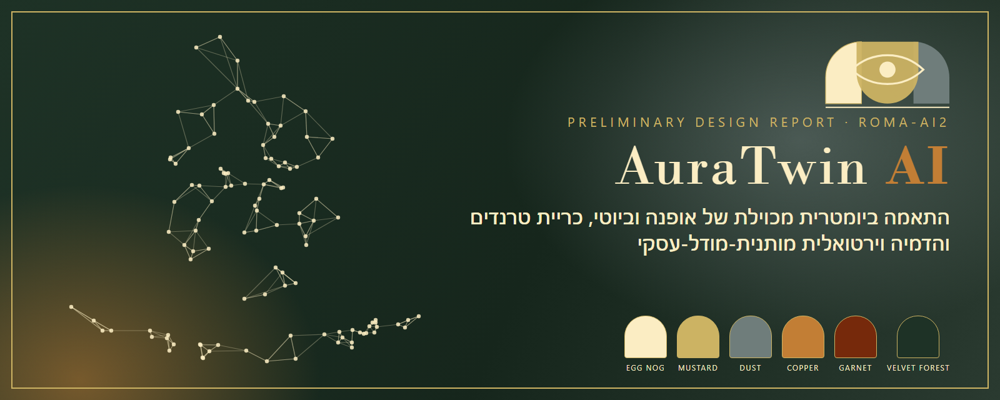

**רוני אופיר · מעיין שירי**, החוג לסטטיסטיקה, אוניברסיטת חיפה · מנחה: ד"ר יורם סגל
יישומי AI ו-Vibe Coding במדע וביום-יום, 2026 · קוד קבוצה `roma-ai2`

📄 **[report/report.pdf](report/report.pdf)** · 📋 [PRD.md](PRD.md) · 🧠 [prompts/](prompts/) · 📝 [CHANGELOG.md](CHANGELOG.md) · 🧩 [skills/](skills/)

</div>

---

## החזון · Vision

**למה העולם צריך את זה עכשיו.** הבינה המלאכותית כבר כותבת, מתכנתת, מנווטת ומשווה מחירים בשבילנו. אבל ההחלטה
שחוזרת אצל רוב האנשים מדי בוקר, איך להיראות היום, עדיין מתקבלת מול מראה בתאורת חדר, בניחוש של גוון, מידה
ושילוב. **AURAM** הוא תוסף דפדפן ואפליקציה נלווית שהופכים את הניחוש להחלטה מכוילת, בשני הרגעים
שבהם היא נדרשת: בבוקר מול הארון, ובזמן קנייה מקוונת.

**למי.** הקהל רחב וחוצה גילים ומגדרים:
- **נערות** שבונות סגנון אישי ומושפעות מטרנדים שמתחלפים בתוך שבועות;
- **נשים בכל גיל** שמשלבות לבוש, איפור וציפורניים בזמן מוגבל;
- **גברים** בעלי מודעות גבוהה לטיפוח ולסגנון, שרוצים למקסם את הופעתם בלי להפוך למומחים.

אין בממשק ברירות מחדל מגדריות: ההמלצה נקבעת לפי הגוף והגוון, לא לפי הנחה.

**How it works.** The user's colours are calibrated with biometric anchors in the eye: the sclera, measured once
with a screen flash, and the self-reported eye colour as a Bayesian prior. Body circumferences come from SMPL-X
plus the reported height. A multimodal RAG engine matches the catalogue against live social trends. A distilled
diffusion try-on runs only behind a value-exchange gate (a 15 s rewarded video, an affiliate click or VIP), so
every generation is paid for before the GPU starts.

### The 4-step user journey (report Fig. 4.4)

| # | Step | Budget | Measured by |
|---|---|---|---|
| 1 | Onboarding in 30 seconds: eye colour, height, weight, circumferences, 3 snapshots (face, body, hands) | ≤ 30 s, once | REQ-VIS-02 |
| 2 | Instant daily / shopping assistant: outfit, makeup shade, nail polish, live trends | ≤ 1.8 s | REQ-LAT-05, REQ-REC-10, REQ-TRD-09 |
| 3 | Value-exchange gate (optional): 15 s rewarded video or VIP unlocks a try-on of *me* | 15 s + ≤ 4.5 s | REQ-GEN-06/07/08, REQ-BIZ-12 |
| 4 | 1-click sponsored shop-the-look cards at paying retail partners | 1 click | REQ-REC-10 |

## Visual identity — "Luxury, Vintage, Bold"

| Swatch | Name | Hex | RGB | Role in the report |
|---|---|---|---|---|
|  | **Egg Nog** | `#FBEDC3` | 251, 237, 195 | soft backgrounds of boxes, cards, cover, logo |
|  | **Mustard** | `#CCB363` | 204, 179, 99 | antique-gold rules and frames, flagship series |
|  | **Dust** | `#6F7D7B` | 111, 125, 123 | sub-headings, system boxes, axes, competitors |
|  | **Copper** | `#C27E35` | 194, 126, 53 | examples, **AURAM / proposed solution**, section numbers |
|  | **Garnet** | `#76290B` | 118, 41, 11 | warnings, critical risks, critical path |
|  | **Velvet Forest** | `#1E3226` | 30, 50, 38 | chapter titles, cover frame, table headers |

The **Pocket-Mirror logo** (v2.0) is an opened vintage compact mirror seen at a flattering 3/4 angle:
- **lid**: Velvet Forest case with a Copper edge and a sculpted Mustard rim, tilted for the 3/4 view;
- **glass**: an Egg Nog to Dust diagonal sheen, with an **AI sparkle** inside a thin Copper iris contour
  (personal beauty, reflection, calibration);
- **clasp and hinge**: an Egg Nog pearl on a Mustard collar, and a Mustard/Copper hinge;
- **base**: a compact pad in perspective, with a Garnet side band and concentric Mustard / Egg Nog rings.

It is a TikZ macro (`\auratwinlogo`, used on the cover, in every page header and in the app mockup) and a PNG
generated from identical geometry (`scripts/render_hyperframes_cover.py`).

## Preview of the compiled report

| | | |
|:-:|:-:|:-:|
| 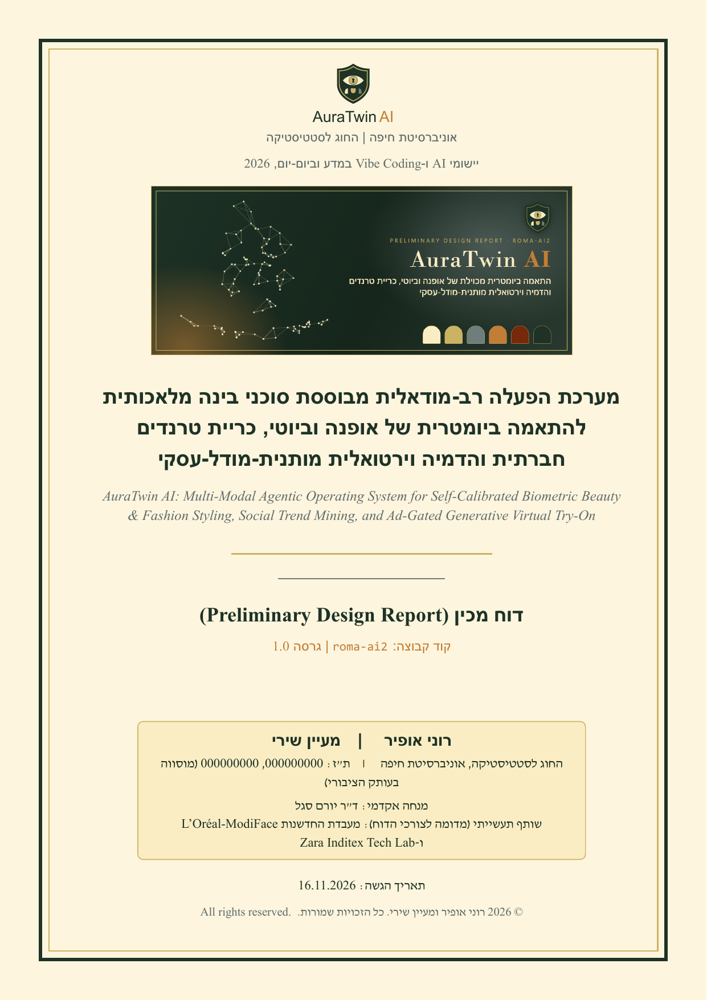<br>Cover (א׳) | 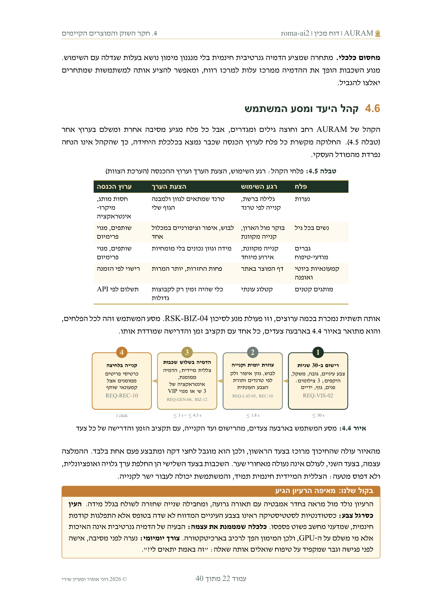<br>Audience & user journey (Ch. 4) | 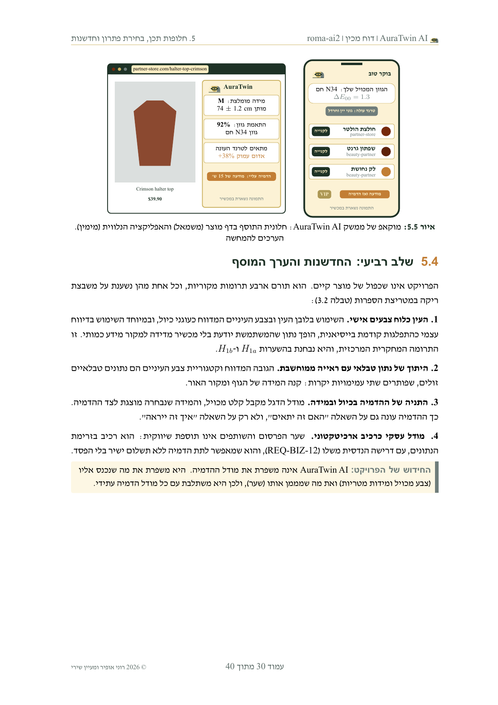<br>Extension + app mockup (Ch. 5) |
| <br>Radar chart | <br>Log-scale scatter | <br>Architecture & data flow |
| 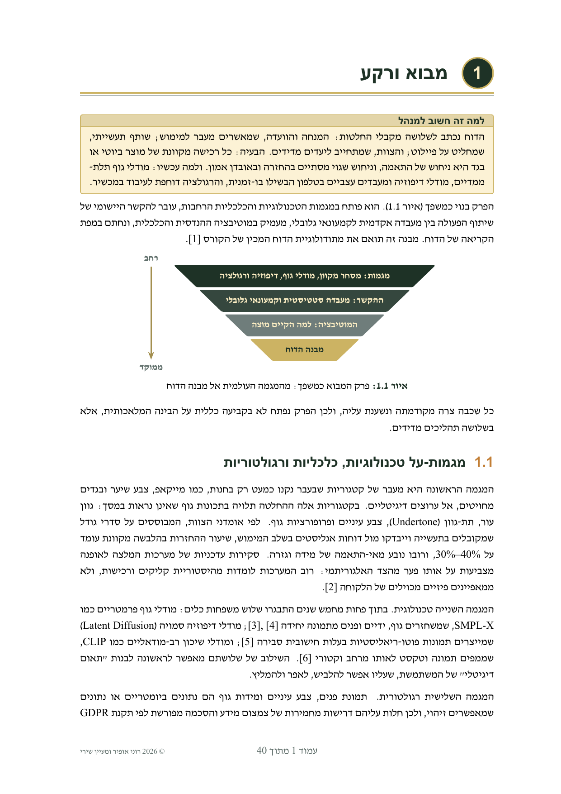<br>Introduction funnel (p.1) | 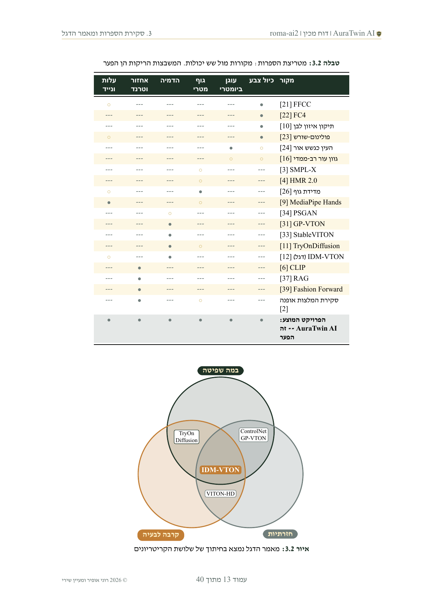<br>Flagship Venn (p.14) | 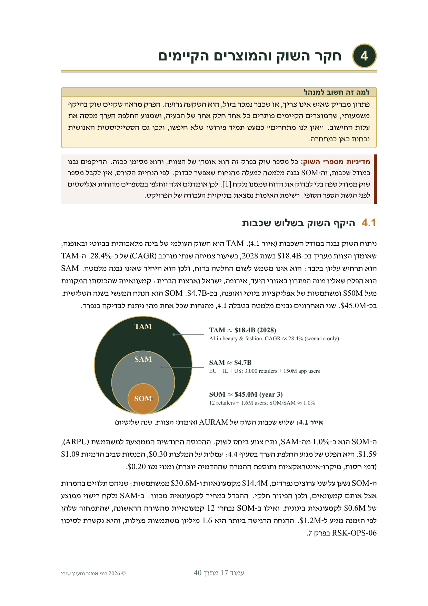<br>Market layers (p.17) |
| 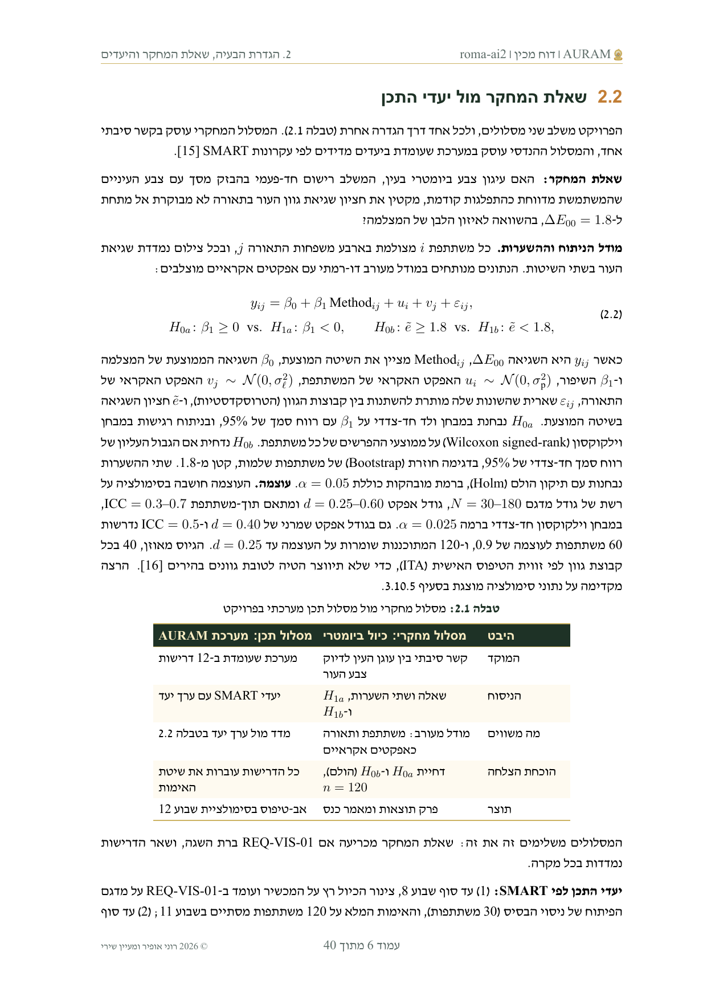<br>H₀ vs H₁, eq. 2.1 (Ch. 2) | 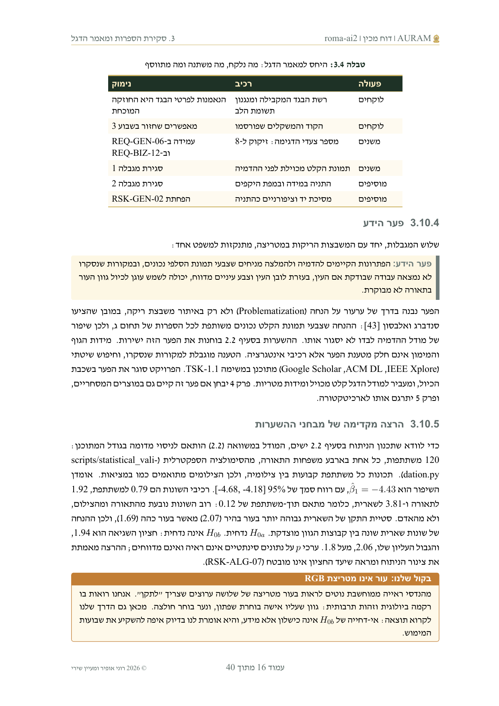<br>Simulated pilot test (Ch. 3) | 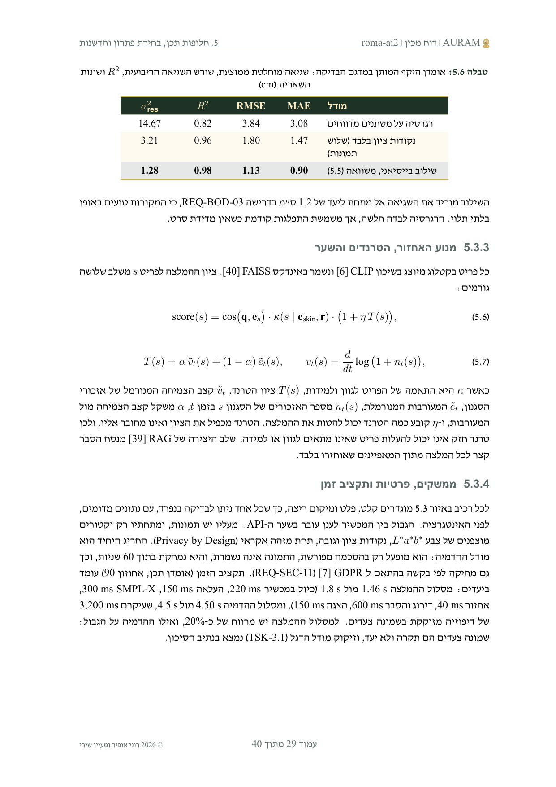<br>Bayesian circumference fusion (Ch. 5) |
| 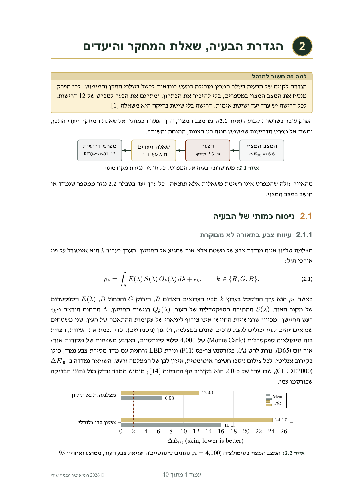<br>Spectral image formation, eq. 2.1 (Ch. 2) | 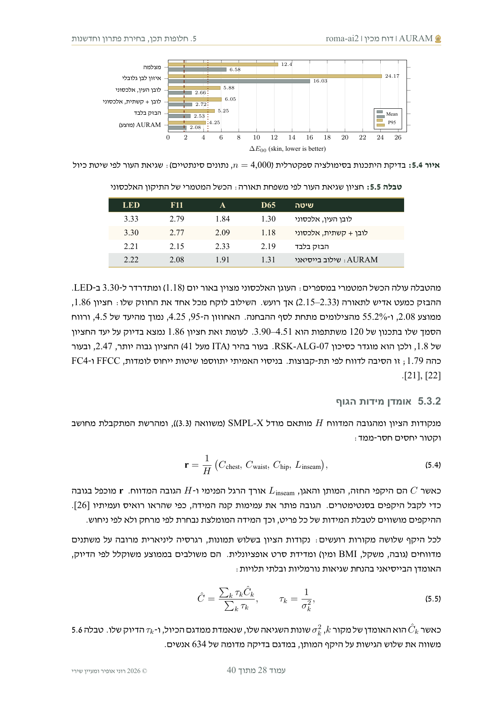<br>Metameric failure by illuminant (Ch. 5) | 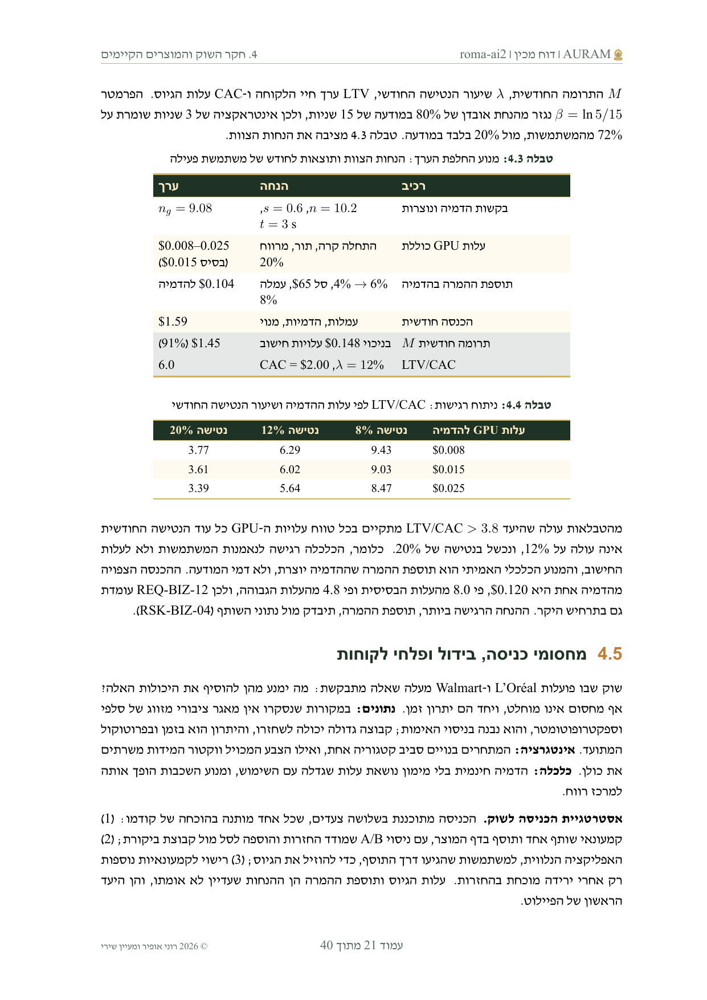<br>Three-tier economics, LTV/CAC grid (Ch. 4) |
| 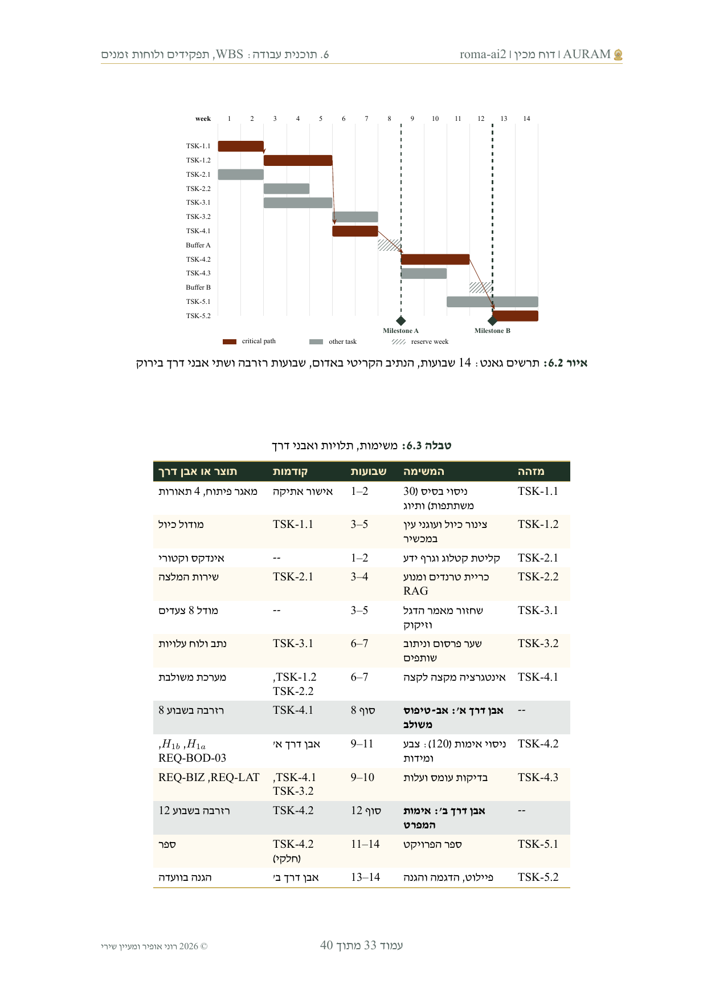<br>RACI & 14-week Gantt | <br>5×5 risk heatmap | 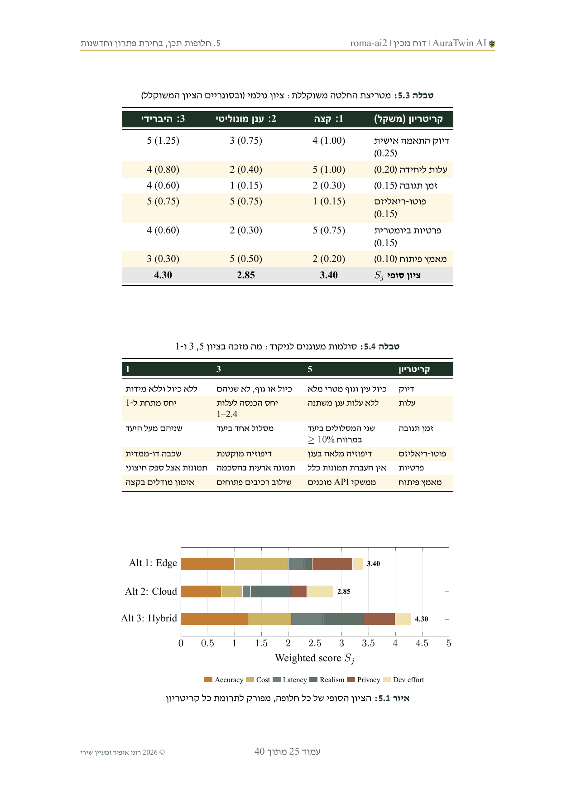<br>Pugh matrix |

## Key numbers (all computed by the Python pipeline below)

| What | Value | Where |
|---|---|---|
| Skin colour error, phone camera, spectral simulation (D65 / A / F11 / LED, n = 4,000) | mean ΔE₀₀ = 6.58, P95 = 12.40 | Ch. 2 |
| Gray-world white balance on selfies | worse: mean 16.03 | Ch. 2 |
| AURAM: flash delta + eye anchor, Bayesian fusion | median 1.86, mean 2.08, P95 4.25 (meets 4.5); diagonal anchor alone degrades from 1.18 (D65) to 3.30 (LED): metameric failure | Ch. 5 |
| Decision matrix (weights frozen before scoring, anchored scales) | Hybrid **4.30** · Edge 3.40 · Cloud 2.85; 0 flips in 28 ±1 score changes | Ch. 5 |
| Three-tier value-exchange engine (team assumptions) | revenue $1.59 / user / month, contribution $1.45, **LTV/CAC 6.0**; > 3.8 at every GPU cost $0.008–0.025 while churn ≤ 12 %, fails at 20 % | Ch. 4 |
| Market (team estimates, bottom-up) | SAM ≈ $4.7B, SOM ≈ $45.0M (year 3) | Ch. 4 |
| Simulated pilot, crossed mixed-effects model (120 × 4 illuminants) | β₁ = -4.43 [-4.68, -4.18], ICC 0.12; H₀a rejected; **H₀b not rejected** (median 1.94, upper bound 2.06 > 1.8) | Ch. 2–3 |
| Waist circumference, 30% hold-out (n = 634) | keypoints MAE 1.47 cm · OLS regression 3.08 · **Bayesian fusion 0.90** (RMSE 1.13, R² 0.98, σ²res 1.28) | Ch. 5 |
| Monte-Carlo weight perturbation of the Pugh matrix | 20,000 Dirichlet draws: Alt 3 wins 100%, 5th-pct margin 0.47; uniform weights 89.2% | Ch. 5 |

## The Python pipeline that drives the report

Every number in the charts and statistical tables is produced by seeded Python scripts. LaTeX reads the CSV
files directly (`pgfplots` `table{...}`), and a checker fails the build if a number in the text drifts from
the script output.

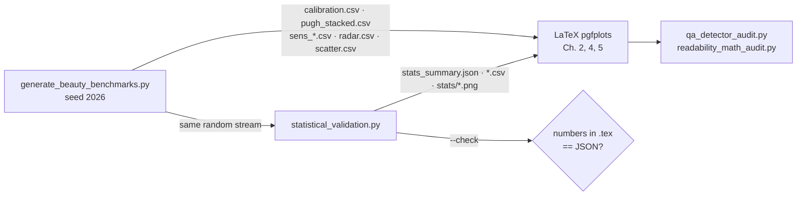

| Script | What it computes | Outputs | Used in |
|---|---|---|---|
| `scripts/generate_beauty_benchmarks.py` + `scripts/spectral_optics.py` | CIEDE2000 (self-tested), spectral image formation (illuminants D65/A/F11/LED, sclera redness/yellowing/tear-film specular, screen-flash delta), 4,000-selfie calibration simulation, tier economics and LTV/CAC grid, Pugh matrix and sensitivity, power, unit economics, market build-up | `report/figures/data/*.csv`, `report/work/benchmarks_summary.md` | Figs 2.2, 4.2, 4.3, 5.2–5.4; Tables 4.3, 5.3 |
| `scripts/statistical_validation.py` | crossed mixed-effects model (statsmodels), Wilcoxon, Holm, cluster bootstrap; power grid N × d × ICC; OLS + Bayesian circumference fusion; Monte-Carlo Pugh replay | `report/figures/data/stats_summary.json`, `power_grid.csv`, `pilot_participant_differences.csv`, `circumference_metrics.csv`, `pugh_montecarlo.csv`, `report/figures/stats/*.png` | eq. 2.2, Sec. 3.10.5, Tables 5.6, Sec. 5.2.4 |
| `scripts/uncertainty_voi.py` (v3.5) | hierarchical Bayesian posterior of the median error (Gibbs), design value per illuminant family, hardware sensitivity (room light × burst length), LTV/CAC Monte Carlo with EVPI/EVPPI, latency-vs-margin constraint map | `uncertainty_summary.json`, `posterior_median.csv`, `hardware_burst*.csv`, `ltv_cac_distribution.csv`, `voi_ranking.csv` | Sec. 4.4, 5.3.2, 5.3.7, Figs. 4.4, 5.5, 5.7 |
| `scripts/qa_detector_audit.py` | 9 QA families on the compiled PDF and log (page budget, BiDi, overflows, versions) | `report/work/qa_audit_report.md` | release gate |
| `scripts/readability_math_audit.py` | spacing, punctuation, every equation symbol defined in a "כאשר" sentence | `report/work/readability_math_audit.md` | release gate |

```bash
python scripts/generate_beauty_benchmarks.py           # rewrites report/figures/data/*.csv (byte-identical on re-run)
python scripts/statistical_validation.py --check       # writes JSON/CSV/PNG and verifies the numbers in the chapters
```

| | | |
|:-:|:-:|:-:|
| 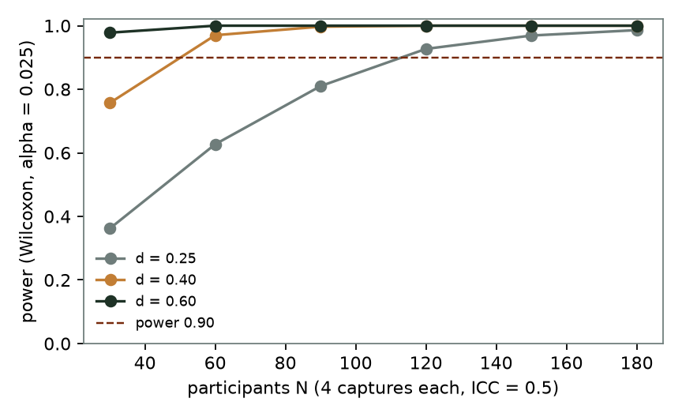<br>Power grid (N × d, ICC = 0.5) | 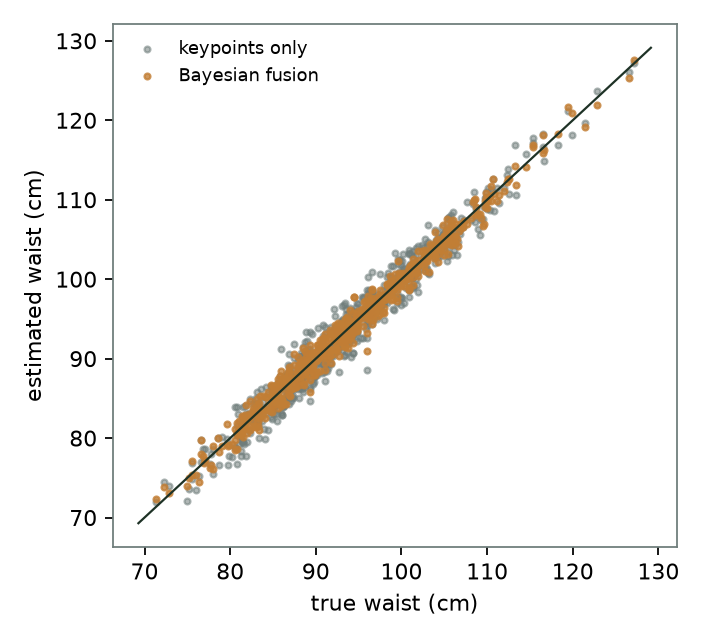<br>Keypoints vs Bayesian fusion | 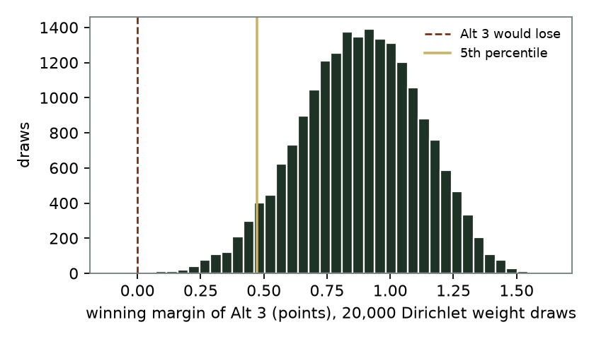<br>Pugh winning margin, 20,000 draws |

> All data are **synthetic** (stated in the report): the scripts validate the analysis pipeline and the design
> targets, not real-world effect sizes. That is also why the power analysis uses the conservative d = 0.4.

## The 12 agent skills

| # | Skill | Role | Report contribution |
|---|---|---|---|
| 1 | `expert-committee-prd` | 4-persona committee | `PRD.md`: page map, rubric, traceability, frozen Pugh weights |
| 2 | `cls-template-architect` | template factory | two-layer LuaLaTeX class, B4 stress test, versions 1.0 → 2.0 |
| 3 | `academic-source-researcher` | sources | 46 IEEE references, literature matrix, verification checklist |
| 4 | `beauty-ai-domain-architect` | equations & data | ΔE₀₀/MAP/SMPL-X/RAG/Pugh maths, simulation and economics script |
| 5 | `scientific-hebrew-writer` | Hebrew author | third-person chapters with BiDi macros and page budget |
| 6 | `visual-tikz-pgfplots-artist` | illustrator | 19 TikZ/pgfplots figures, HTML→PNG cover |
| 7 | `bidi-qa-detector` | detects only | `scripts/qa_detector_audit.py`, 9 QA families |
| 8 | `bidi-qa-fixer` | fixes only | template-level vs one-off fixes, version bumps |
| 9 | `red-team-examiner` | strict examiner | fresh-context reviews: 73 → 83/100 (content), 78/100 visual pass in iteration 3 → fixes |
| 10 | `ux-entrepreneur-strategist` | UX & product | human need, audience, journey (Fig. 4.4), UI mockup (Fig. 5.5) |
| 11 | `luxury-vintage-ui-designer` | art director | palette, Pocket-Mirror logo, editorial chapter openings, cover |
| 12 | `human-readability-math-auditor` | copy-editor & math | spacing, BiDi punctuation, every equation symbol defined |

Execution record: [`report/work/skills_execution_log.md`](report/work/skills_execution_log.md).

## How the QA loop worked

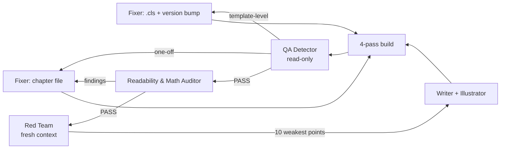

- **Stress test B4:** 5 template bugs were each fixed once in the class (v1.2.0).
- **Detector:** went 72 → … → 0 findings. It also enforces the page budget, which is now exactly on target
  (1, 4, 8, 17, 23, 31, 35, 37, references 38).
- **Readability & math audit:** set 6 pt paragraph spacing and roomier tables and boxes (with an 11.5 pt body to
  keep 40 pages). Hebrew definitions were added for every symbol in 7 equations.
- **Red team:** 73/100 at first. The upgrade pass covered the H1a/H1b statistics, the anchored Pugh scales, the
  gate economics, the privacy contradiction, the work plan and the risks, giving 83/100. All 6 new items were then
  fixed. The remaining partial points are documented: market and ad inputs are estimates awaiting sources, and the
  P95 target is an open question.

> **Source policy.** Web search was not used in this session. Every reference is a well-known peer-reviewed work,
> cited without invented DOIs. Every market figure is labelled as a team estimate. Students verify each item with
> [`report/work/source_verification_checklist.md`](report/work/source_verification_checklist.md). The industrial
> partner is **simulated**, and the retailer names in the mockup are placeholders.

## Repository

```text
├── README.md · PRD.md · CHANGELOG.md · VERSION
├── .claude/skills/ (12)  ·  skills/ (mirror)
├── prompts/   00–07: every user prompt verbatim (credentials redacted) + stage prompts + session log
├── scripts/   generate_beauty_benchmarks.py · statistical_validation.py · render_hyperframes_cover.py
│              qa_detector_audit.py · readability_math_audit.py
└── report/    base-report.cls · auratwin-report.cls · PROMPT.md · COMMANDS.md · main.tex · coverpage.tex
               references.bib · chapters/ch1…ch8 · figures/ (data, stats, logo, previews) · work/ (audits, logs) · report.pdf
```

### Prompt sequence (`prompts/`)

| File | What it is |
|---|---|
| [`00_initial_master_prompt.md`](prompts/00_initial_master_prompt.md) | the 40-page master prompt, verbatim |
| [`00_user_session_prompts_log.md`](prompts/00_user_session_prompts_log.md) | chronological log of every user message |
| [`01_user_rejects_ux_luxury_design_prompt.md`](prompts/01_user_rejects_ux_luxury_design_prompt.md) | rejects: UX, Luxury-Vintage palette, readability |
| [`02_committee_prd_and_architecture_prompts.md`](prompts/02_committee_prd_and_architecture_prompts.md) | committee / PRD stage prompts |
| [`03_cls_template_and_luxury_styling_prompts.md`](prompts/03_cls_template_and_luxury_styling_prompts.md) | class-template stage prompts |
| [`04_chapter_writing_and_ux_prompts.md`](prompts/04_chapter_writing_and_ux_prompts.md) | chapter writing and UX prompts |
| [`05_bidi_readability_and_red_team_prompts.md`](prompts/05_bidi_readability_and_red_team_prompts.md) | BiDi QA, readability and red-team prompts |
| [`06_user_design_corrections_prompt.md`](prompts/06_user_design_corrections_prompt.md) | 7 design corrections + GitHub sync (password redacted) |
| [`06_iteration3_pocket_mirror_logo_and_red_team_polish.md`](prompts/06_iteration3_pocket_mirror_logo_and_red_team_polish.md) | pocket-mirror logo + 12-skill red-team polish |
| [`07_assignment01_feedback_alignment_and_git_collab.md`](prompts/07_assignment01_feedback_alignment_and_git_collab.md) | alignment with the Assignment 01 feedback + two-author Git |
| [`prompt_01_antigravity`](prompts/prompt_01_antigravity) | Roni's red-team audit prompt to Antigravity (input only) |
| [`08_antigravity_elon_musk_upgrade_prompt.md`](prompts/08_antigravity_elon_musk_upgrade_prompt.md) | AURAM rebrand, spectral physics, mixed model, tiered economics |
| [`09_pass1_completeness_and_shark_tank_prompt.md`](prompts/09_pass1_completeness_and_shark_tank_prompt.md) | Pass 1: report completeness, evidence status, edge cases, go-to-market |
| [`10_pass2_visual_luxury_layout_prompt.md`](prompts/10_pass2_visual_luxury_layout_prompt.md) | Pass 2: visual polish, chart labels, lists page, overfull tables |
| [`11_pass3_language_bidi_readability_prompt.md`](prompts/11_pass3_language_bidi_readability_prompt.md) | Pass 3: topic sentences, terminology, BiDi and spacing scans |
| [`12_pass4_final_audit_release_prompt.md`](prompts/12_pass4_final_audit_release_prompt.md) | Pass 4: final fresh-context audit (66/100, 15 items) and fixes |

## Build

```bash
cd report
lualatex -interaction=nonstopmode -jobname=report main.tex
biber report
lualatex -interaction=nonstopmode -jobname=report main.tex
lualatex -interaction=nonstopmode -jobname=report main.tex      # or: sh build.sh
cd ..
python scripts/generate_beauty_benchmarks.py
python scripts/statistical_validation.py --check
python scripts/qa_detector_audit.py --report-dir report
python scripts/readability_math_audit.py --report-dir report
```

Requirements: MiKTeX (LuaHBTeX) with polyglossia, biblatex-ieee, tcolorbox, pgfplots; Windows fonts David, Arial,
Times New Roman and Consolas; Python 3 with numpy, scipy, matplotlib and Pillow; Microsoft Edge or Chrome (headless) for the PNG assets.

## Privacy

The cover page carries no ID numbers (removed in v3.5, prompt 13); submission date 24.11.2026.

---
© 2026 רוני אופיר ומעיין שירי · Course methodology and booklets © Dr. Yoram Segal.
