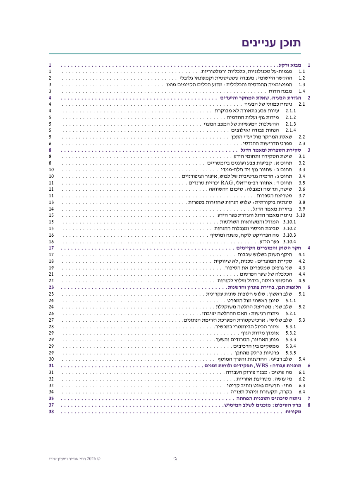
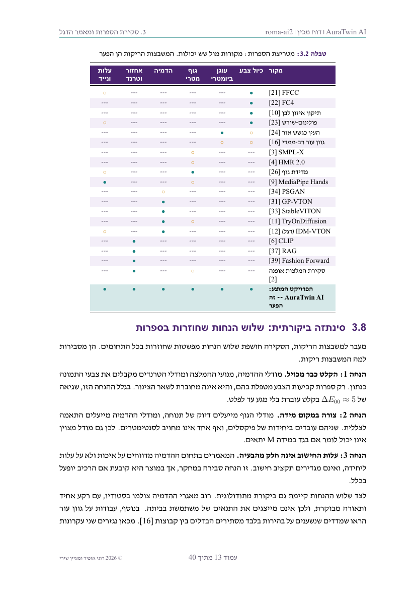
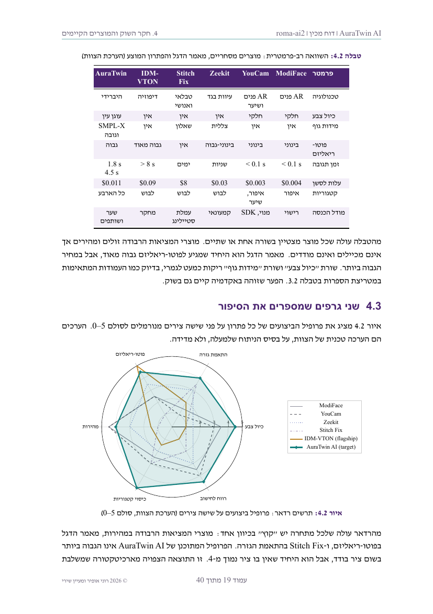
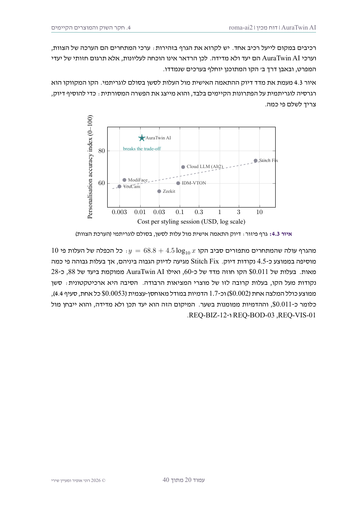
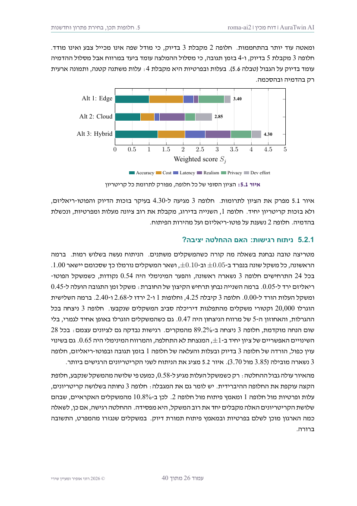
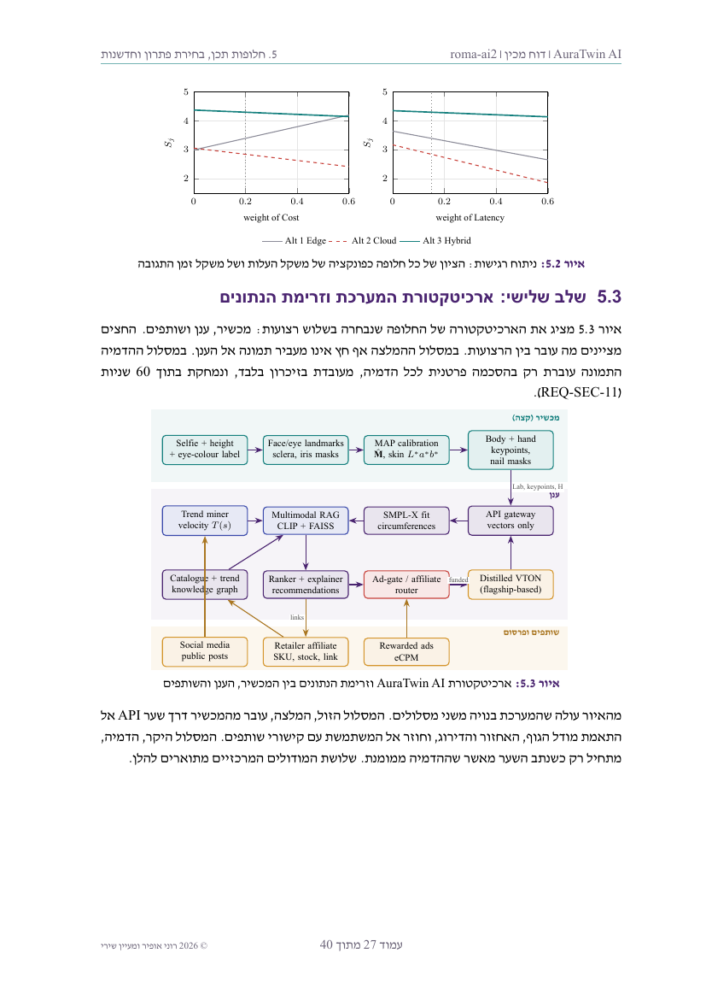

<div align="center">

# AuraTwin AI — דוח מכין (Preliminary Design Report)

**Multi-Modal Agentic Operating System for Self-Calibrated Biometric Beauty & Fashion Styling,
Social Trend Mining, and Ad-Gated Generative Virtual Try-On**


**רוני אופיר · מעיין שירי** — החוג לסטטיסטיקה, אוניברסיטת חיפה · מנחה: ד"ר יורם סגל
קורס: יישומי AI ו-Vibe Coding במדע וביום-יום / סמינריון מחקרי בניהול טכנולוגיות, 2026

📄 **[report/report.pdf](report/report.pdf)** — the compiled 44-page report

</div>

---

## על הפרויקט · About

הדוח המכין הוא **חוזה הנדסי ומחקרי** לפני שלב המימוש: הוא מוכיח שהבעיה אמיתית, שהפתרון אפשרי,
ושיש תוכנית של 14 שבועות לבצע אותו. **AuraTwin AI** מכיילת את צבעי המשתמשת בעזרת עוגנים ביומטריים
בעין (לובן העין + צבע עיניים מדווח כהתפלגות קודמת בייסיאנית), אומדת היקפי גוף במודל SMPL-X,
ממליצה בעזרת אחזור רב-מודאלי (RAG) המשלב טרנדים מהרשתות, ומפעילה הדמיה גנרטיבית רק מאחורי שער
פרסום/שותפים שמממן את עלות החישוב.

The report was produced with the course method *"describe in words, the model writes, you sign"*:
a team of agent **skills** (expert committee → template architect → researcher → domain architect →
writer → illustrator → QA detector → QA fixer → red team), a two-layer LuaLaTeX class, and a full
detect → fix → recompile loop.

## Key numbers (all computed by `scripts/generate_beauty_benchmarks.py`)

| What | Value | Where |
|---|---|---|
| Skin colour error, phone camera, uncontrolled light (simulation, n = 4,000) | mean ΔE₀₀ = 4.89, P95 = 8.89 | Ch. 2 |
| Gray-world white balance on selfies | worse: mean 9.77 | Ch. 2 |
| Proposed eye-anchored calibration (enrolment + iris prior) | median 1.37, mean 1.82, P95 4.81 (CI 4.20–5.48) | Ch. 5 |
| Decision matrix (weights frozen before scoring, anchored scales) | Hybrid **4.30** · Edge 3.40 · Cloud 2.85 | Ch. 5 |
| Robustness | 0 winner flips in 28 single-score changes; wins 100 % of Dirichlet weight draws; crossover only at cost weight 0.58 | Ch. 5 |
| Unit economics of a gated try-on (q = 0.5) | revenue $0.054 vs commercial API $0.045–0.090 (ratio 0.6–1.2) vs self-hosted distilled $0.0053 (**ratio 10.2**) | Ch. 4 |
| Market (team estimates, bottom-up) | SAM ≈ $3.0B, SOM ≈ $27.4M (year 3) | Ch. 4 |

> **Source policy.** Web search was not used in this session, so every paper in `references.bib` is a well-known
> peer-reviewed work cited without invented DOIs or page numbers, and every market figure is explicitly labelled
> as a team estimate. The students verify each item with
> [`report/work/source_verification_checklist.md`](report/work/source_verification_checklist.md) before final submission.
> The industrial partner (L'Oréal-ModiFace / Zara Inditex Tech Lab) is **simulated** for the exercise.

## Preview

| | | |
|:-:|:-:|:-:|
| <br>Cover (א׳) | <br>TOC (ג׳) | <br>Literature matrix |
| <br>Radar chart | <br>Log-scale scatter | <br>Pugh matrix |
| <br>Architecture & data flow | <br>14-week Gantt | <br>5×5 risk heatmap |

## Page map (booklet Table 1.1)

| Part | Pages | Content |
|---|---|---|
| Preliminary | א׳–ד׳ | cover (no page number) · executive summary + 7 keywords · TOC (depth 3) · lists + abbreviations |
| 1 Introduction | 1–3 | funnel: trends → applied context → motivation → roadmap |
| 2 Problem, research question, goals | 4–7 | quantified status quo, H1a/H1b + power, SMART goals, 12 requirements |
| 3 Literature & flagship paper | 8–16 | 4 knowledge domains, synthesis matrix, flagship IDM-VTON, gap |
| 4 Market & products | 17–22 | TAM/SAM/SOM, technical teardown, radar, log scatter, unit economics |
| 5 Alternatives, selection, innovation | 23–30 | 3 alternatives, anchored Pugh matrix + sensitivity, architecture, innovation |
| 6 Work plan | 31–34 | WBS, RACI, Gantt (critical path, buffers, 2 milestones), KPIs |
| 7 Risks | 35–36 | R = P×I, 5×5 heatmap, 8 risks, mitigation/contingency/residual |
| 8 Summary | 37 | design readiness + 3 immediate actions |
| References | 38–40 | 46 IEEE entries (biblatex + biber), all cited |

## Repository structure

```text
├── README.md · PRD.md · CHANGELOG.md · VERSION
├── .claude/skills/          # 9 agent skills (SKILL.md)
├── skills/                  # mirror of .claude/skills for GitHub visibility
├── prompts/                 # every user prompt + all stage prompts (00–05)
├── scripts/
│   ├── generate_beauty_benchmarks.py   # simulation, Pugh, sensitivity, power, unit economics, market
│   ├── render_hyperframes_cover.py     # HTML/CSS → PNG cover (headless Edge/Chrome)
│   └── qa_detector_audit.py            # read-only QA detector (9 families)
└── report/
    ├── base-report.cls · auratwin-report.cls     # two-layer LuaLaTeX template
    ├── PROMPT.md · COMMANDS.md                   # template manual and command list
    ├── main.tex · coverpage.tex · references.bib · chapters/ch1…ch8
    ├── figures/ (data/*.csv, cover, previews/)   · tests/ (Prompt B4 stress test)
    ├── work/  (QA audit, fix log, red-team review, source checklist)
    └── report.pdf
```

## Agent skills

| # | Skill | Role |
|---|---|---|
| 1 | `expert-committee-prd` | 4-persona committee writes `PRD.md` (requirements + 100-point rubric) first |
| 2 | `cls-template-architect` | builds `base-report.cls` + thin `auratwin-report.cls`, versions, docs, stress test |
| 3 | `academic-source-researcher` | real sources only, `references.bib`, literature matrix |
| 4 | `beauty-ai-domain-architect` | equations (ΔE₀₀, MAP calibration, SMPL-X, trend score, Pugh, unit economics) |
| 5 | `scientific-hebrew-writer` | third-person Hebrew prose with BiDi macros and page budget |
| 6 | `visual-tikz-pgfplots-artist` | TikZ / pgfplots figures ≤ 12.4 cm, HyperFrames-style cover |
| 7 | `bidi-qa-detector` | **detects only** — never edits; writes `report/work/qa_audit_report.md` |
| 8 | `bidi-qa-fixer` | **fixes only** — repeating → template + version bump; one-off → chapter |
| 9 | `red-team-examiner` | strict 10-weakest-points review in a fresh context; resolution log |

## How the QA loop went

- **Template stress test (Prompt B4)** found 5 template bugs. One example: `\en` was unboxed, so the list
  `RAG, SMPL-X` rendered as `SMPL-XRAG`. All 5 were fixed once in the class, giving v1.2.0.
- **Detector/fixer rounds** went 72 → 35 → 69 → 24 → 7 → 1 findings. The template-level fixes became v1.2.1.
  For example, the bibliography was overflowing its 3-page budget, and the TOC and lists spilled onto extra pages.
- **Red team (fresh context, different model)** scored the first full draft **73/100** with 10 substantive weaknesses.
  The re-check of the revision gave **83/100**: 4 points resolved, 6 partially resolved, 0 open. Its 6 new findings were
  then fixed. The remaining partial points are documented honestly: market and ad inputs are estimates still awaiting
  sources, and the P95 calibration target is an open research question. See `report/work/red_team_review.md`.
- **Final state:** detector verdict **PASS**: 44 pages, 0 LaTeX errors, 0 undefined references, 0 overfull boxes > 5 pt,
  every chapter on its budgeted page, 46/46 references cited.

## Build (booklet §13.4)

```bash
cd report
lualatex -interaction=nonstopmode -jobname=report main.tex
biber report
lualatex -interaction=nonstopmode -jobname=report main.tex
lualatex -interaction=nonstopmode -jobname=report main.tex
# or: sh build.sh
python ../scripts/qa_detector_audit.py --report-dir .     # from the repo root: --report-dir report
```

Requirements: MiKTeX (LuaHBTeX) with polyglossia, biblatex-ieee, tcolorbox, pgfplots; Windows fonts
David / Arial / Times New Roman / Consolas; Python 3 with numpy (and Pillow for previews).

## Privacy

ID numbers are masked (`000000000`) in this public copy, following the booklet (p. 6, 75). The full details
appear only in the copy submitted to the advisor.

---
© 2026 רוני אופיר ומעיין שירי. Course methodology and booklets © Dr. Yoram Segal.
